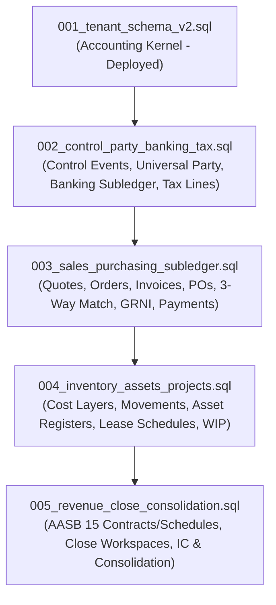

# SDLC 22: Architectural Rectification and Master Schema Roadmap

## 1. Executive Summary & Purpose
This document formally rectifies architectural contradictions across previous SDLC documents (SDLC 01–21) and the Master Context (`docs/Project_AX_Master_Context.md`), resolves accounting inaccuracies identified in the Phase 3B Accounting Event Matrix, and establishes the definitive data and application architecture for **HRT Systems (Project AX)**.

---

## 2. Architectural Rectifications & Invariants

### 2.1. Multi-Tenancy Architecture
* **Rectified Decision:** **Schema-per-Tenant** is the mandatory baseline architecture for all tenants across all tiers.
* **Resolution of Prior Contradiction:** Early notes in `SDLC_02` and `docs/07_Database_and_Multi_Tenancy_Deep_Dive.md` proposed a hybrid "Shared Schema + RLS for Standard Tier / Dedicated Schema for Pro Tier". This is superseded by `SDLC_21` and `db/sql/001_tenant_schema_v2.sql`.
* **Rationale:**
  1. **Zero Data Leakage:** Database-level schema isolation prevents catastrophic cross-tenant leakage caused by missing `WHERE tenant_id = ...` application bugs or query optimizer edge-cases.
  2. **Zero Version Drift:** The Radical TG Control Plane (`SDLC_19`) orchestrates and runs idempotent migrations (`001_...`, `002_...`) sequentially across all tenant schemas.
  3. **High-Performance Reporting:** Per-tenant indexes and materialized summary balances (`period_balances`) eliminate multi-tenant index bloat and noisy-neighbor locking.
  4. **Enterprise Tier:** Fully isolated **Database-per-Tenant** is supported by targeting a dedicated PostgreSQL cluster or database instance via the Control Plane routing table.

### 2.2. Technology Stack & Deployment Model
* **Backend:** **Python + FastAPI** (Async-native, Modular Monolith).
* **Database Source of Truth:** **PostgreSQL 16+** with strict relational integrity, trigger-enforced double-entry constraints, and audit logging.
* **Orchestration & Asynchronous Workflows:** **Temporal.io** for durable executions, long-running integrations (Xero, Salesforce, HubSpot, Banking feeds), multi-day approval workflows, and end-of-month batch runs.
* **Frontend:** **React / Next.js** with TypeScript, Tailwind CSS, and shadcn/ui.
* **Resolution of Prior Contradiction:** Exploratory mentions of microservices, Kafka, RabbitMQ, BullMQ, NestJS, Go, and C# in `docs/03_System_Architecture.md`, `05_API_Design.md`, and `06_Concurrency_and_Scaling.md` are deprecated. AX is strictly a **Modular Monolith** sharing an in-process event bus and database connection pool. External integrations buffer through FastAPI and process durably via Temporal.

### 2.3. Accounting Kernel Invariants & The Posting Lineage
* **Rule 1: Strict Separation of Concerns:**
  $$\text{Business Object} \neq \text{Business Event} \neq \text{Accounting Event} \neq \text{Ledger Entry}$$
* **Rule 2: Zero Direct Writes to the GL:**
  No module, UI form, integration, or external system (including Payroll or legacy imports) may insert directly into `accounting_events` or `ledger_entries`. All transactions must enter as a `business_event`, pass through the versioned rules engine, and generate a balanced set of ledger entries.
* **Rule 3: Absolute Financial Immutability:**
  Financial history is append-only. Triggers `HRT-IMMUTABLE` prevent `UPDATE`, `DELETE`, or `TRUNCATE` on all posted accounting tables. Corrections must be executed via formal reversing accounting events (`reverses_accounting_event_id`).
* **Rule 4: Universal Separation of Statuses:**
  A single status enum is prohibited. Operational objects maintain separate independent lifecycle statuses:
  - `workflow_status`: DRAFT, SUBMITTED, APPROVED, REJECTED
  - `accounting_status`: PENDING_ACCOUNTING, ACCOUNTED, FAILED, SKIPPED
  - `settlement_status`: UNPAID, PARTIALLY_PAID, PAID, OVERPAID
  - `reconciliation_status`: UNRECONCILED, MATCHED, RECONCILED
  - `tax_status`: DRAFT, ASSESSED, REPORTED, SETTLED

---

## 3. Rectification of the Accounting Event Matrix (Phase 3B)

The detailed review of `SDLC_06` through `SDLC_11` identified 16 critical accounting, tax, and structural defects. The authoritative corrections are defined below:

| # | Event / Area | Defect in Previous Docs | Rectified Accounting Standard & Implementation |
|---|---|---|---|
| **1** | **Revenue vs Billing** | Event 1 credited Revenue upon Invoice issuance, and Event 8 also credited Revenue from Unearned Revenue (double-counting revenue). | **AASB 15 Compliance:** Billing $\neq$ Revenue. Invoicing creates Dr AR, Cr Contract Liability (or Billing Clearing). Revenue is recognised independently via Performance Obligation satisfaction schedules (Dr Contract Liability / Dr Contract Asset, Cr Revenue). |
| **2** | **AU GST on Deposits** | Event 5 stated GST on deposits is "generally withheld". | **A New Tax System (GST) Act 1999 s29-5:** For commercial contracts, GST is attributable upon receipt of consideration (even partial deposits).AX automatically generates **Cr GST Payable** on receipt of commercial deposits. Security deposits held in trust (s99-5) are exempt until forfeited or applied. |
| **3** | **Payment & Bank Clearing** | Events credited `Bank` directly at the payment initiation date without clearing accounts. | **Payment Clearing Engine:** Payments initially post to a **Payment Clearing Account** (Dr AP, Cr Payment Clearing). When the bank statement line clears and is reconciled, an entry moves funds: Dr Payment Clearing, Cr Bank. |
| **4** | **Unallocated Cash & Fees** | Event 2 lacked handling for unallocated receipts, overpayments, and merchant fees. | Receipts post Dr Bank, Cr AR (if matched) OR Cr **Unapplied Customer Cash** (liability). Payment gateway fees (e.g., Stripe) post Dr Merchant Processing Expense in the same balanced entry. |
| **5** | **Procurement & GRNI** | Event 7 omitted the Goods Received Not Invoiced (GRNI) clearing account. | 3-way matching workflow: <br>1. Goods Receipt: Dr Inventory / Expense, Cr **GRNI Clearing Account**. <br>2. Supplier Invoice: Dr **GRNI Clearing**, Dr GST Receivable, Cr AP. <br>3. Invoice Price Variance: Dr/Cr Purchase Price Variance if invoice differs from PO. |
| **6** | **Payroll Accounting** | SDLC_05 credited Super out of gross pay. Incomplete tax scope. | **Superannuation Guarantee (SG):** Superannuation is an employer cost over and above gross wages. Posting: Dr Wages Expense, Dr Employer Super Expense, Cr PAYG Withholding Payable, Cr Superannuation Payable, Cr Net Wages Clearing. |
| **7** | **Project WIP Accounting** | Event 13 debited Project WIP while also crediting AP/Wages (doubling operational costs). | Project costs originate from AP bills or Timesheets. Project WIP tracking is handled as a **reclassification** (Dr Project WIP, Cr Cost Absorption / Labour Recovery) or managed off-ledger via operational project cost ledgers. |
| **8** | **Capital WIP vs Contract WIP** | Event 30 conflated AASB 116 CWIP (internal capital assets) with AASB 15 contract WIP. | Strict separation: **Account 1500 (Capital Work in Progress - AASB 116)** capitalises into Property, Plant & Equipment. **Account 1400 (Contract Assets / WIP - AASB 15)** amortises into COGS or transfers to Billed AR. |
| **9** | **Consolidation Eliminations** | Event 20 stated "Dr Inventory to eliminate internal markup". | **Elimination Standard:** Eliminating unrealised intercompany margin requires **Dr Intercompany Sales, Cr Intercompany COGS**, and **Dr Group COGS, Cr Inventory** for the remaining unrealised profit portion. |
| **10** | **Tax Settlement & Refunds** | Event 14 handled only net payable BAS; no refund path or PAYG instalment handling. | **AU BAS Engine:** Supports both Net Payable (Cr ATO Payable) and Net Refund (Dr ATO Receivable). Netting handles GST Collected (1A), GST Paid (1B), PAYG Withholding (4), and PAYG Income Tax Instalment (5A). |
| **11** | **Lease Accounting (AASB 16)** | Event 28 burned liability purely via principal cash, omitting interest unwinding. | Periodic lease schedule posts: Dr Lease Liability (principal portion), Dr Lease Interest Expense (effective interest portion), Cr Lease Clearing / Cash; plus Dr Depreciation Expense, Cr Accumulated Amortisation (Right-of-Use Asset). |
| **12** | **Inventory Valuation (AASB 102)** | Event 17 conflated inventory shrinkage with Net Realisable Value (NRV) write-down. | **AASB 102.34 Separation:** Shrinkage/Damage is a permanent physical write-off (Dr Inventory Shrinkage Expense, Cr Inventory Asset). NRV adjustment uses an allowance account (Dr NRV Loss, Cr Allowance for Inventory Write-Down), allowing subsequent upward recovery. |
| **13** | **Control Events Engine** | Non-posting events (Bank Rec, Period Close, Approvals) lacked schema representation. | Implementation of `control_events` table for governance events that do not generate financial journals, maintaining database-level auditability without violating the double-entry 2-line constraint on `accounting_events`. |
| **14** | **Foreign Exchange (AASB 121)** | Event 18 revalued all foreign lines indiscriminately. | **Monetary vs Non-Monetary Split:** Only monetary items (Cash, AR, AP, Debt) are revalued at closing spot rates. Non-monetary items (Prepayments, Inventory, Fixed Assets, Contract Liabilities) remain at historical rates. |
| **15** | **Open Items Constraints** | `open_items` enforced `original_amount > 0`, breaking Credit Notes and overpayments. | Schema updated to allow negative open items (`item_type IN ('AR','AP')` with signed balances), linking directly to tax lines and currency specifications. |
| **16** | **Universal Party Model** | `parties` table used a flat single-role string `party_type`. | Universal Party pattern implemented: `parties` (Legal Entity/Individual) $\to$ `party_roles` (Customer, Supplier, Employee, Intercompany) $\to$ `party_profiles` (specific credit terms and accounts). |

---

## 4. Subledger Data Architecture Roadmap

To progress from the minimal Accounting Kernel (`001_tenant_schema_v2.sql`) to the full operational ERP to spec, the database architecture is partitioned into four sequential migrations:



### 4.1. Migration 002: Control Events, Universal Party, Banking & Tax
* **Control Events:** Non-posting governance ledger (`control_events`).
* **Universal Party:** `party_roles`, `party_profiles`, `party_bank_accounts` (with dual-authorization fraud controls), `bank_account_change_requests`, and `party_tax_registrations`.
* **Banking Subledger:** `bank_accounts` (GL linked), `bank_statements`, `bank_statement_lines`, `bank_reconciliation_sessions`, and `bank_reconciliation_matches`.
* **Tax Engine:** Transaction-level `tax_lines` (taxable base, tax amount, recoverable %, BAS labels) and `tax_returns` (statutory BAS/GST filings).
* **Open Items Fix:** Negative amount support for Credit Notes and unapplied deposits.

### 4.2. Migration 003: Sales & Procurement Subledgers
* **Sales / AR Documents:** `sales_orders`, `customer_invoices`, `customer_invoice_lines`, `credit_notes`, `payment_receipts`, `receipt_allocations`.
* **Purchasing / AP Documents:** `purchase_orders`, `purchase_order_lines`, `goods_receipts` (GRNI), `supplier_invoices`, `supplier_invoice_lines`, `payment_proposals`, `payment_batches` (ABA export).
* **Matching Engine:** Automated 2-way and 3-way line matching with configurable quantity and price tolerances.

### 4.3. Migration 004: Inventory, Fixed Assets, Leases & Projects
* **Inventory Subledger:** `items`, `units_of_measure`, `inventory_locations`, `cost_pools`, `inventory_movements`, `cost_layers` (FIFO / Weighted Average), and `inventory_counts`.
* **Fixed Assets & Leases:** `assets`, `asset_books` (AASB & Tax books), `depreciation_schedules`, `lease_contracts` (AASB 16), `lease_schedules`.
* **Projects & WIP:** `projects`, `project_phases`, `tasks`, `timesheets`, `project_rates`, `project_wip_entries`.

### 4.4. Migration 005: Revenue Recognition, Close & Consolidation
* **AASB 15 Engine:** `revenue_contracts`, `performance_obligations`, `revenue_schedules`, `revenue_recognition_runs`.
* **Period Close Workspace:** `close_workspaces`, `close_tasks`, `close_checklist_items`, `subledger_period_statuses`.
* **Intercompany & Consolidation:** `intercompany_transactions`, `intercompany_matches`, `consolidation_groups`, `consolidation_group_members`, `consolidation_runs`, `consolidation_elimination_entries`.

---

## 5. Backend Application Architecture (FastAPI Modular Monolith)

The backend directory structure enforces Domain-Driven Design (DDD) bounded contexts while maintaining a single, unified deployment unit:

```
backend/
├── app/
│   ├── main.py                     # FastAPI application entrypoint & middleware
│   ├── config.py                   # Environment configuration (Pydantic Settings)
│   ├── core/
│   │   ├── database.py             # asyncpg connection pool & schema-per-tenant router
│   │   ├── security.py             # JWT verification, RBAC, Data Scopes
│   │   ├── context.py              # ContextVar storing current tenant_id & actor_id
│   │   ├── exceptions.py           # Standardised HRT error handlers
│   │   └── outbox.py               # Outbox publisher worker
│   ├── accounting_kernel/          # Core Domain: The financial truth engine
│   │   ├── models.py               # SQLAlchemy/SQLModel representations of Kernel tables
│   │   ├── events.py               # Business Event & Accounting Event schemas
│   │   ├── rules_engine.py         # Versioned accounting rule interpreter
│   │   ├── posting_service.py      # Immutable double-entry transaction poster
│   │   └── period_service.py       # Period open/close/reopen gatekeeper
│   ├── modules/                    # Operational Bounded Contexts
│   │   ├── party/                  # Universal Party, Profiles, Bank account approvals
│   │   ├── banking/                # Bank feeds, statements, reconciliation engine
│   │   ├── tax/                    # AU GST/BAS calculation, tax returns
│   │   ├── ar/                     # Billing, Customer Invoices, Credit Notes, Cash Allocations
│   │   ├── ap/                     # POs, Goods Receipts, Supplier Invoices, 3-Way Match, ABA
│   │   ├── inventory/              # Items, Stock Movements, Cost Layers
│   │   ├── assets/                 # Fixed Asset registers, Depreciation, AASB 16 Leases
│   │   ├── projects/               # Projects, Timesheets, WIP billing
│   │   └── revenue/                # AASB 15 Contracts, Obligations, Recognition Schedules
│   └── temporal/                   # Long-running workflows and integrations
│       ├── client.py               # Temporal client connection
│       ├── workflows/              # Ingestion, Month-End, FX Reval, Webhook replay workflows
│       └── activities/             # Database posting activities, external API calls
└── pyproject.toml                  # Python package configuration & dependencies
```
