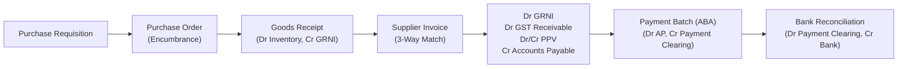
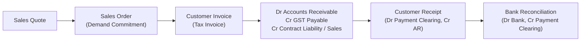

# SDLC 24: Sales & Procurement Subledgers (Quote-to-Cash & Procure-to-Pay)

## 1. Executive Summary & Purpose
This document establishes the operational workflows, technical data contracts, and accounting event linkages for **Sales & Accounts Receivable (Domain 6)** and **Procurement & Accounts Payable (Domain 7)** in HRT Systems.

Following the core invariant:
$$\text{Operational Document} \xrightarrow{\text{Validated}} \text{Business Event} \xrightarrow{\text{Rules Engine}} \text{Accounting Event} \xrightarrow{\text{Kernel}} \text{General Ledger}$$
No operational screen or document directly writes to the ledger. Instead, operational lifecycle transitions emit immutable `business_events` that the Accounting Kernel interprets according to approved accounting rule versions.

---

## 2. Procure-to-Pay (P2P) Architecture

### 2.1. End-to-End Operational Lifecycle


### 2.2. The Goods Received Not Invoiced (GRNI) Accrual Engine
In traditional basic accounting software (like standard Xero), receiving goods generates no balance sheet footprint until the supplier bill arrives. In an enterprise ERP, physical custody of goods represents an asset and a matching accrued liability.

1. **Step 1: Goods Receipt (`GoodsReceived` Event):**
   - The warehouse clerk or project manager acknowledges delivery against a Purchase Order line.
   - Financial entry generated by the Kernel:
     $$\text{Debit: 1400 Inventory on Hand (or 6000 Operating Expense)}$$
     $$\text{Credit: 2150 Goods Received Not Invoiced (GRNI Clearing)}$$
2. **Step 2: Supplier Invoice Capture (`SupplierInvoiceAccounted` Event):**
   - The accounts payable clerk enters the supplier's bill and links it to the Goods Receipt and PO lines.
   - Financial entry generated by the Kernel:
     $$\text{Debit: 2150 Goods Received Not Invoiced (GRNI Clearing)}$$
     $$\text{Debit: 1310 GST Receivable (Input Tax Credit)}$$
     $$\text{Debit / Credit: 5100 Purchase Price Variance (PPV - if price differs from PO)}$$
     $$\text{Credit: 2000 Accounts Payable (Subledger Open Item)}$$
3. **Step 3: Supplier Payment (`SupplierPaymentPosted` Event):**
   - Financial entry generated by the Kernel:
     $$\text{Debit: 2000 Accounts Payable (Open Item Cleared)}$$
     $$\text{Credit: 1020 Payment Clearing Account}$$
4. **Step 4: Bank Feed Settlement (`BankTransactionMatched` Control Event):**
   - When the actual bank statement debit clears:
     $$\text{Debit: 1020 Payment Clearing Account}$$
     $$\text{Credit: 1010 Operating Bank Account}$$

### 2.3. Automated 3-Way Matching Engine
The system compares three independent records before approving a supplier invoice for payment:
1. **Purchase Order:** Authorized quantity and contracted unit price.
2. **Goods Receipt:** Actual physical quantity accepted and verified.
3. **Supplier Invoice:** Invoiced quantity and billed unit price.

```
Match Condition: Invoiced Qty <= Received Qty AND Invoiced Price == PO Price
```

* **Tolerances:** Configurable percentage (e.g. 1%) or absolute dollar threshold (e.g. $5.00). Invoices within tolerance auto-approve; invoices exceeding tolerance require explicit controller override (`VARIANCE_APPROVED`).

### 2.4. Australian Banking Association (ABA) Direct Credit Engine
HRT Systems natively generates statutory Australian **ABA (Direct Entry)** files from approved payment batches:
* **Batch Header (Descriptive Record 0):** BSB of financial institution, reel sequence number, user name, description.
* **Detail Records (Record 1):** BSB, account number, indicator, transaction code (50 - General Credit), amount in cents, beneficiary title, lodgement reference, trace BSB/account, remitter name.
* **Batch Trailer (Record 7):** Total net credit amount, total debit/credit records count.
* **Anti-Fraud Guard:** The user who generated or edited the payment batch **cannot** approve it for ABA download (`CHECK (status <> 'APPROVED' OR approved_by <> created_by)`).

---

## 3. Quote-to-Cash (Q2C) Architecture

### 3.1. End-to-End Operational Lifecycle


### 3.2. AASB 15 Separation: Billing $\neq$ Revenue
Unlike entry-level software, issuing a customer invoice does not automatically recognize revenue if performance obligations remain unsatisfied.

1. **Standard Immediate Sale:**
   $$\text{Debit: 1200 Accounts Receivable}$$
   $$\text{Credit: 2310 GST Payable (A New Tax System Act s29-5)}$$
   $$\text{Credit: 4100 Sales Revenue}$$
2. **Over-Time / Deposit / Advance Billing:**
   $$\text{Debit: 1200 Accounts Receivable}$$
   $$\text{Credit: 2310 GST Payable}$$
   $$\text{Credit: 2400 Contract Liability (Unearned Revenue)}$$
   *Revenue is recognized subsequently via the AASB 15 revenue schedule runs:*
   $$\text{Debit: 2400 Contract Liability}$$
   $$\text{Credit: 4100 Sales Revenue}$$

### 3.3. Negative Open Items & Credit Notes
HRT Systems allows signed amounts on the `open_items` subledger table (`original_amount <> 0`).
* **Invoices:** Positive amount ($+1,100.00$).
* **Credit Notes:** Negative amount ($-200.00$).
* **Allocations:** `open_item_allocations` supports:
  - 1-to-1: Single receipt paying a single invoice.
  - 1-to-many: Single lump-sum payment covering 20 invoices.
  - Many-to-1: Multiple partial payments and credit notes settling one invoice.
  - Credit application: Applying a credit note to an invoice without cash movement.

---

## 4. Document Freezing & Immutability Architecture

Once an operational document moves from `DRAFT` to `APPROVED` or `ISSUED`:
1. **Trigger Enforcement (`trg_freeze_operational_document`):**
   - Database trigger intercepts any `UPDATE` or `DELETE` attempt.
   - Financial fields (`subtotal_amount`, `tax_amount`, `total_amount`, `currency_code`) become read-only.
   - Deletion is physically rejected with error `HRT-DOC-001`.
2. **Cryptographic Fingerprint (`document_hash`):**
   - The document header calculates a SHA-256 hash across its canonical payload:
     $$\text{document\_hash} = \text{SHA256}(\text{id} \parallel \text{entity\_id} \parallel \text{total\_amount} \parallel \text{currency\_code} \parallel \text{timestamp})$$
3. **Auditing Corrections:**
   - Any correction to an issued invoice must occur via a formal **Credit Note** and subsequent re-issuance, guaranteeing that auditor paper-trails perfectly mirror the software database state.
