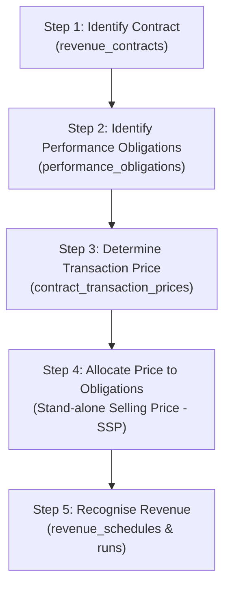

# SDLC 26: Revenue Recognition, Group Consolidation, Close Workspace & Audit Portal

## 1. Executive Summary & Purpose
This document establishes the advanced accounting engines, group reporting structures, continuous close workflows, and external integration perimeters for:
* **AASB 15 / IFRS 15 5-Step Revenue Recognition Engine (Domain 13)**
* **Multi-Entity Intercompany Mirroring & Group Consolidation (Domain 16)**
* **Continuous Period Close Workspace & Subledger Reconciliations (Domain 17)**
* **Evidence Provenance & Auditor Portal PBC (Domain 19)**
* **High-Availability Ingress Perimeter & Dead-Letter Replay (Domain 20)**

---

## 2. AASB 15 / IFRS 15 Revenue Recognition Engine

### 2.1. The Fundamental Mandate: $\text{Billing} \neq \text{Revenue} \neq \text{Cash}$
Entry-level accounting software conflates billing with revenue: issuing an invoice immediately credits a revenue account. Under AASB 15 / IFRS 15, revenue is recognized **only when control of the promised goods or services transfers to the customer** (satisfaction of performance obligations).

### 2.2. Balance Sheet Positions: Contract Assets vs. Contract Liabilities
* **Contract Liability (Deferred / Unearned Revenue - Account 2400):**
  A customer is billed in advance or pays before work is completed.
  1. Advance Billing Event:
     $$\text{Debit: 1200 Accounts Receivable } \$120,000.00$$
     $$\text{Credit: 2310 GST Payable } \$12,000.00$$
     $$\text{Credit: 2410 Contract Liability (Unearned Revenue) } \$120,000.00$$
  2. Monthly Revenue Release Event (`RevenueRecognised`):
     $$\text{Debit: 2410 Contract Liability } \$10,000.00$$
     $$\text{Credit: 4200 Subscription Revenue } \$10,000.00$$

* **Contract Asset (Unbilled Revenue / WIP - Account 1400):**
  Services are delivered over time (e.g. milestone or percentage-of-completion), but billing terms dictate invoicing at a future date.
  1. Performance Delivered Event:
     $$\text{Debit: 1410 Contract Asset (Earned Unbilled) } \$15,000.00$$
     $$\text{Credit: 4100 Project Revenue } \$15,000.00$$
  2. Subsequent Billing Event:
     $$\text{Debit: 1200 Accounts Receivable } \$16,500.00$$
     $$\text{Credit: 1410 Contract Asset (WIP Cleared) } \$15,000.00$$
     $$\text{Credit: 2310 GST Payable } \$1,500.00$$

---

## 3. Intercompany Trading & Group Consolidation (Domain 16)

### 3.1. Automated Mirror Invoicing
When Subsidiary A issues a \$50,000 invoice to Subsidiary B:
1. Subsidiary A creates `customer_invoices` (Dr Intercompany AR, Cr Intercompany Revenue).
2. The Accounting Kernel triggers the Intercompany Engine.
3. The system automatically creates a mirror `supplier_invoices` record inside Subsidiary B's schema (Dr Intercompany Expense / Inventory, Cr Intercompany AP).
4. Both records are linked in `intercompany_transactions` with status `MATCHED`.

### 3.2. Group Consolidation Elimination Entries (AASB 10 / AASB 128)
When consolidating multiple subsidiaries into the parent holding entity:
1. **Eliminate Intercompany Balances:**
   $$\text{Debit: 2050 Intercompany Accounts Payable } \$50,000.00$$
   $$\text{Credit: 1250 Intercompany Accounts Receivable } \$50,000.00$$
2. **Eliminate Intercompany Trading:**
   $$\text{Debit: 4900 Intercompany Revenue } \$50,000.00$$
   $$\text{Credit: 5900 Intercompany Cost of Goods Sold } \$50,000.00$$
3. **Eliminate Unrealized Profit in Ending Inventory:**
   *If Subsidiary B still holds goods purchased from Subsidiary A at a 20% internal markup (\$10,000 profit):*
   $$\text{Debit: 5010 Group Consolidated COGS } \$10,000.00$$
   $$\text{Credit: 1401 Consolidated Inventory on Hand } \$10,000.00$$

---

## 4. Continuous Period Close Workspace (Domain 17)

### 4.1. The Continuous Close Philosophy
Traditional accounting platforms enforce a stressful, multi-day "Month-End Panic". HRT Systems implements a **Continuous Close Workspace** that continuously calculates subledger variances in real time:

| Subledger | Control Account in GL | Subledger Source Table | Balance Check |
|---|---|---|---|
| **AR** | 1200 Accounts Receivable | `open_items` WHERE item_type = 'AR' | Sum of open balances $==$ Account 1200 |
| **AP** | 2000 Accounts Payable | `open_items` WHERE item_type = 'AP' | Sum of open balances $==$ Account 2000 |
| **Bank** | 1010 Operating Bank | `bank_statement_lines` | Reconciled balance $==$ Account 1010 |
| **GRNI** | 2150 Goods Received Not Invoiced | `goods_receipt_lines` unmatched | Unbilled receipts $==$ Account 2150 |
| **Inventory** | 1400 Inventory Asset | `inventory_cost_layers` active | Sum of remaining cost $==$ Account 1400 |
| **Fixed Assets** | 1510 PPE & 1519 Accum Deprec | `asset_books` Net Book Value | Asset register NBV $==$ GL PPE Net |
| **Tax** | 1310 GST Rec & 2310 GST Pay | `tax_lines` unfiled | Net tax line sum $==$ Net GST Control |
| **Revenue** | 2400 Contract Liabilities | `performance_obligations` remaining | Remaining obligation $==$ Account 2400 |

A period can only move to `CLOSED` status once all mandatory subledger reconciliation gates report `variance == 0` (or have an approved explanation).

---

## 5. Auditor Portal & PBC (Provided by Client) Workflow (Domain 19)

### 5.1. Scoped Auditor Access
External auditors (PwC, EY, KPMG, BDO, or boutique SME auditors) are assigned the scoped role `EXTERNAL_AUDITOR`:
* Read-only access to the General Ledger, Trial Balance, and Subledger registers.
* Direct drill-down to hashed source documents (`evidence_files`).
* Zero write access to any financial table.

### 5.2. Native PBC Sample Ticket System
Instead of managing audit requests across emails and spreadsheets:
1. The auditor creates a request in `auditor_portal_requests` selecting a sample of 25 transactions.
2. The internal finance team responds directly in `auditor_portal_items`, attaching justifications and linking directly to the system's `business_events`.
3. The auditor verifies the cryptographic SHA-256 hash of the evidence file, certifying that source documents were not altered after the close.

---

## 6. Integration Ingress Perimeter & Dead-Letter Replay (Domain 20)

### 6.1. High-Availability Ingress Buffer
To prevent external webhook timeouts and dropped network requests:
1. External webhook arrives (e.g. HubSpot Deal Won, Monday Task Complete, ServiceM8 Job Finished).
2. FastAPI instantly validates the unique `idempotency_key` and saves the raw payload to **`inbox_events`**.
3. FastAPI immediately responds with HTTP `202 Accepted`.
4. **Temporal.io** durable worker picks up the inbox record:
   - Resolves external IDs using `external_system_mappings`.
   - Translates the operational payload into an authorized `business_event`.
   - Passes the event to the Accounting Kernel rules engine.

### 6.2. Dead-Letter Queue & Human Replay
If an integration fails (e.g. an external CRM introduces a new unmapped project code):
1. The record moves to `integration_dead_letters`.
2. The system notifies the finance admin in the Integration Workspace.
3. The admin fixes the mapping in the UI.
4. Temporal resumes the exact execution workflow from the point of failure, ensuring zero missing transactions.
